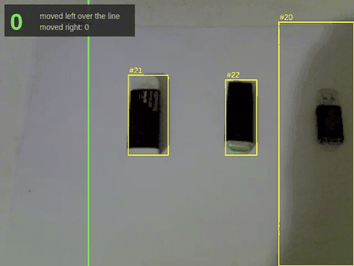

# pi-embedded-lab

Hands-on notes and code from building small Linux images for a Raspberry Pi 3 Model B, once with Yocto and once with Buildroot, and checking the hardware interfaces from userspace. Host: Ubuntu 24.04 for the image builds, upgraded to 26.04 later (the camera work was done on 26.04). The numbers below were measured on this setup; where something was not measured, it says so.

## What is here

| Path | Contents |
|---|---|
| `yocto-lab/meta-lab/` | A small Yocto layer (scarthgap): `hello`, `gpioinfo-mini`, `undervolt-watch` (systemd service that logs the Pi under-voltage flag) and a class that installs an SSH public key |
| `yocto-lab/local.conf.sample` | The `local.conf` lines this lab adds (systemd, I2C/SPI, hwmon, USB camera) |
| `buildroot-lab/` | Buildroot config fragment, firmware `config.txt`, rootfs overlay |
| `piproj/` | CMake aarch64 cross-compile project: `hello`, `gpioinfo_mini`, `spi_loopback`, `belt_counter` (see the demo below) |
| `piproj/tools/` | PC-side helpers: `belt_ui.py` (browser control page for `belt_counter`), `pi_cam_relay.py` (live MJPG from the Pi camera to a browser), `pi_monitor.sh` (temperature / under-voltage / load log) |
| `docs/` | [Buildroot vs Yocto](docs/buildroot-vs-yocto.md), [verified results](docs/results.md), [workspace layout](docs/workspace-layout.md) |

Not included: poky, meta-openembedded, meta-raspberrypi (clone them, see below), build output, downloads and images.

## Demo: counting objects on a "belt" with a USB camera



*7-second screen recording of the control page (looping GIF; the full-quality [MP4](docs/belt-counter-demo.mp4) can be downloaded).* A sheet of paper with three small objects is the "belt". The camera is moved to the right over the fixed sheet, so the objects travel to the left across the green line, and the counter goes from 0 to 3.

How it works: `belt_counter` runs on the Pi (C, V4L2, YUYV 320x240 at 30 fps). Each frame it estimates the brightness and colour of the sheet, finds objects that differ from it, tracks them and counts how many cross the line. The PC runs `belt_ui.py`, a small Python server that starts the program over SSH and shows the live image, the boxes and the counter in a browser, with Start, Stop and Reset buttons and sliders for the line position and the sensitivity.

On the Pi 3 it takes about 6 ms per frame (about 20 % of one core, about 10 % of the whole CPU including SSH, measured while 15 images per second were sent to the PC; the clip above was recorded with 30). The detection is plain C without any vision library.

```bash
cmake -S piproj -B piproj/build -DCMAKE_TOOLCHAIN_FILE=piproj/cmake/aarch64-linux-gnu.cmake
cmake --build piproj/build --target belt_counter
ssh root@<pi> 'cat > /home/root/belt_counter && chmod +x /home/root/belt_counter' < piproj/build/belt_counter
PI_HOST=<pi address> PI_KEY=<private key> python3 piproj/tools/belt_ui.py   # then open http://localhost:8080/
```

What the clip shows, and what it does not:
- One run, three of three objects counted, nothing counted that should not have been. The program has a built-in self-test with synthetic frames (`belt_counter --selftest`) that passes on the PC and on the Pi; the real-object result is a single run, not a statistic.
- The large yellow box at the right edge in the first seconds is the shadowed part of the sheet. It was tracked as an "object" but never crossed the line, so it was not counted. It is a false detection that is visible in the clip.
- It assumes even, shadow-free lighting, as on a belt station with controlled light. Shadows and glare can create false boxes or hide objects. A white object on white paper is invisible.
- Not tested yet: repeatability over many runs, speed limits, the opposite direction with real objects, and several objects very close together.

## Build the Yocto image

```bash
mkdir yocto-lab && cd yocto-lab
git clone -b scarthgap https://git.yoctoproject.org/poky
git clone -b scarthgap https://git.openembedded.org/meta-openembedded
git clone -b scarthgap https://git.yoctoproject.org/meta-raspberrypi
# put this repo's yocto-lab/meta-lab next to them
# last tested commits: poky 6b7c106, meta-openembedded 2db6aec, meta-raspberrypi 018d444
source poky/oe-init-build-env build
# add the layers to conf/bblayers.conf (meta-oe, meta-python, meta-networking, meta-raspberrypi, meta-lab)
# append the lines from local.conf.sample to conf/local.conf and set LAB_SSH_PUBKEY
bitbake core-image-minimal
```

`LAB_SSH_PUBKEY` must be set in your own `local.conf`; the class refuses to build without it, and no key is stored in this repo.

## Build the Buildroot image

```bash
# Buildroot 2026.02.3 unpacked next to this repo's buildroot-lab/ folder
LAB=$PWD/buildroot-lab; OUT=$LAB/out; BR=<path to buildroot-2026.02.3>
make -C $BR O=$OUT raspberrypi3_64_defconfig
sed "s|@LAB@|$LAB|g" $LAB/lab.fragment.in >> $OUT/.config
# put your public key in $LAB/overlay/root/.ssh/authorized_keys (mode 600), see authorized_keys.example
make -C $BR O=$OUT olddefconfig && make -C $BR O=$OUT -j$(nproc)
# result: $OUT/images/sdcard.img
```

## Cross-compile the test programs

```bash
cmake -S piproj -B piproj/build -DCMAKE_TOOLCHAIN_FILE=piproj/cmake/aarch64-linux-gnu.cmake
cmake --build piproj/build
```

The `deploy` target uses `scp`. The Yocto and Buildroot images here use Dropbear, which has no `scp`; copy with `ssh root@<ip> 'cat > /tmp/prog' < prog` instead.

## Safety habits used in this lab

- Before writing an SD card: check the device with `lsblk`, then write, then compare with `cmp`. A returned prompt is not proof of a good write.
- Public SSH key only, no passwords on the target.
- Security settings are measured first and only loosened when really needed.

## License

MIT, see [LICENSE](LICENSE).
